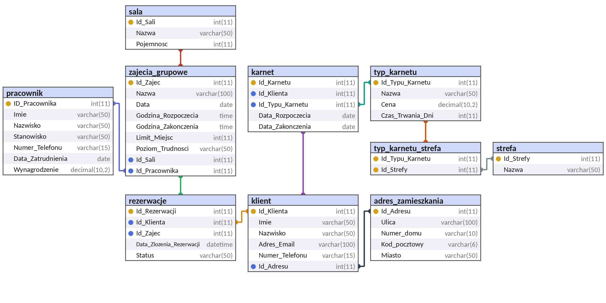

# Baza danych klubu fitness / siłowni

Projekt zaliczeniowy z przedmiotu **Bazy danych**.

**Autorki:** Zuzanna Lech, Amelia Skoczylas

Projekt obejmuje pełny cykl tworzenia bazy danych: specyfikację wymagań i diagram związków encji (ERD), model fizyczny w 3. postaci normalnej, implementację w SQL, testy integralności, raporty w postaci widoków, konta użytkowników z uprawnieniami oraz transakcje i współbieżność.

## Zawartość repozytorium

| Plik | Opis |
|---|---|
| `Bazy_danych_-_projekt_zaliczeniowy.pdf` | Pełna dokumentacja projektu (Etapy 1–3) |
| `projekt_zaliczeniowy.sql` | Zrzut bazy `projekt_zaliczeniowy` (struktura, dane testowe, widoki) |
| `model_bazy_danych.png` | Diagram fizycznego modelu bazy danych (z dokumentacji) |
| `README.md` | Ten plik |

## Technologie

- MariaDB 10.4.32 (silnik InnoDB, kodowanie `utf8mb4`, collation `utf8mb4_polish_ci`)
- phpMyAdmin 5.2.1 (zrzut wygenerowany w phpMyAdmin)

## Model danych



| Tabela | Opis |
|---|---|
| `adres_zamieszkania` | Adresy klientów (jeden adres może być współdzielony przez wielu klientów) |
| `klient` | Klienci klubu |
| `typ_karnetu` | Oferta karnetów: nazwa, cena, czas trwania w dniach |
| `karnet` | Zakup karnetu przez klienta (klient, typ karnetu, daty ważności) |
| `strefa` | Strefy klubu (Siłownia, Basen, Sauna, SPA) |
| `typ_karnetu_strefa` | Tabela łącząca N:M – do jakich stref uprawnia dany typ karnetu |
| `pracownik` | Pracownicy klubu |
| `sala` | Sale i przestrzenie do zajęć |
| `zajecia_grupowe` | Zaplanowane zajęcia (data, godziny, sala, prowadzący) |
| `rezerwacje` | Tabela asocjacyjna klient – zajęcia (relacja N:M) |

**Normalizacja:** złożony atrybut „Termin” rozbito na datę i godziny, a wielowartościowe „Dostępne_Strefy” zastąpiono tabelami `strefa` i `typ_karnetu_strefa` (1NF). Wszystkie tabele mają pojedynczy, sztuczny klucz główny (2NF). Dane adresowe wydzielono do `adres_zamieszkania`, a dane rodzaju karnetu do `typ_karnetu` (3NF). Szczegóły w dokumentacji PDF.

## Uruchomienie

Plik `.sql` nie zawiera instrukcji `CREATE DATABASE`, więc bazę trzeba utworzyć przed importem.

```sql
CREATE DATABASE projekt_zaliczeniowy
  CHARACTER SET utf8mb4
  COLLATE utf8mb4_polish_ci;
```

Import z wiersza poleceń:

```bash
mysql -u root -p projekt_zaliczeniowy < projekt_zaliczeniowy.sql
```

lub w phpMyAdmin: wybierz bazę `projekt_zaliczeniowy` → **Import** → wskaż plik `projekt_zaliczeniowy.sql`.

**Uwagi:**

- Zrzut nie zawiera kont użytkowników opisanych w dokumentacji (sekcja „Użytkownicy i uprawnienia”).
- Widoki mają ustawione `DEFINER=root@localhost`, dlatego import najlepiej wykonać na koncie `root`. Przy błędzie uprawnień można usunąć fragment `DEFINER=...` z definicji widoków.
- Zrzut wygenerowano na MariaDB 10.4.32; na innych wersjach i na MySQL nie był testowany.
- Nazwy tabel i widoków są zapisane małymi literami (ma to znaczenie na systemach rozróżniających wielkość liter, np. Linux).

## Raporty (widoki)

| Widok | Co pokazuje | Użyte mechanizmy |
|---|---|---|
| `raport_sprzedazy_karnetow` | Liczba sprzedanych sztuk i przychód wg typu karnetu | `JOIN`, `COUNT`, `SUM`, `GROUP BY`, `ORDER BY` |
| `ranking_popularnosci_zajec` | Liczba zapisanych osób i wolne miejsca na zajęciach | `LEFT JOIN`, `COUNT`, obliczenia |
| `lista_aktywnych_klientow` | Dane kontaktowe klientów z aktywnym karnetem | podzapytanie w `WHERE ... IN`, `CURDATE()` |
| `klienci_do_aktywizacji` | Klienci z aktywnym karnetem bez żadnej rezerwacji | `JOIN`, `NOT EXISTS` |
| `obciazenie_trenerow` | Liczba zaplanowanych zajęć na pracownika | podzapytanie w `FROM`, `LEFT JOIN` |

```sql
SELECT * FROM raport_sprzedazy_karnetow;
```

> **Uwaga:** widoki `lista_aktywnych_klientow` i `klienci_do_aktywizacji` korzystają z `CURDATE()`, więc ich wyniki zależą od dnia wykonania zapytania. Zrzuty ekranu w dokumentacji pochodzą z maja 2026 r. Zrzut raportu sprzedaży karnetów powstał przed transakcją z punktu 7.1 – w dołączonym pliku `.sql` karnet VIP ma 3 sprzedane sztuki i przychód 4500.00 PLN.

## Użytkownicy i uprawnienia

Kontrola dostępu oparta na rolach, zgodnie z zasadą najmniejszych uprawnień.

| Konto | Rola | Uprawnienia |
|---|---|---|
| `admin` | Administrator bazy | `ALL PRIVILEGES` na bazie `projekt_zaliczeniowy` |
| `user1` | Recepcja | `SELECT, INSERT, UPDATE, DELETE` na `klient`, `karnet`, `rezerwacje`; `SELECT` na `zajecia_grupowe` |
| `user2` | Trener / instruktor | `SELECT` na `zajecia_grupowe` i `sala` |

## Testy

| Obszar | Scenariusz | Wynik |
|---|---|---|
| `NOT NULL` | Dodanie pracownika bez imienia | Odrzucone (#1048) |
| Typy danych | Tekst w polu `DECIMAL` (`Wynagrodzenie`) | **Zaakceptowane** z ostrzeżeniem (#1366) – serwer bez trybu strict |
| Klucz główny | Dodanie sali z istniejącym `Id_Sali` | Odrzucone (#1062) |
| Klucz obcy | Karnet dla nieistniejącego klienta (`Id_Klienta = 9999`) | Odrzucone (#1452) |
| Uprawnienia | `SELECT * FROM Klient` na koncie `user2` | Odmowa dostępu (#1142) |
| Uprawnienia | To samo zapytanie na koncie `user1` | Wykonane poprawnie |
| Transakcje | `COMMIT` – zakup karnetu + zmiana numeru telefonu | Obie zmiany zatwierdzone |
| Transakcje | `ROLLBACK` – błędne usunięcie rezerwacji klienta | Dane przywrócone |
| Współbieżność | Dwie sesje modyfikujące tę samą salę | Druga sesja czeka na zwolnienie blokady wiersza |

## Do poprawy

- **Unikalny e-mail klienta** – brak `UNIQUE` na `klient.Adres_Email`.
- **Tryb strict** – włączenie `STRICT_TRANS_TABLES`, aby niepoprawne wartości liczbowe były odrzucane (Test 2).
- **Dodatkowe ograniczenia** – `CHECK` (np. cena, limit miejsc, daty) oraz `UNIQUE (Id_Klienta, Id_Zajec)` w `rezerwacje`.
- **Klucze obce z `ON DELETE CASCADE`** – usunięcie pracownika, sali lub klienta kasuje powiązane dane; bezpieczniejsze byłoby `RESTRICT`.
- **Uprawnienia `user1`** – konto nie ma dostępu do `adres_zamieszkania` i `typ_karnetu`, potrzebnych do dodania klienta z adresem i sprzedaży karnetu.

## Autorki

- Zuzanna Lech
- Amelia Skoczylas
